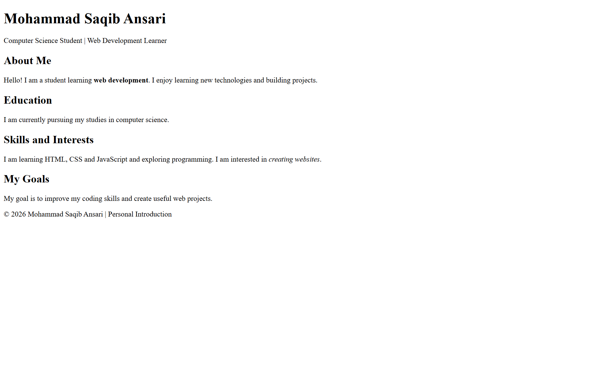

# bcs2026460-saqib-webdev-day02-personal-intro-page

# Personal Introduction Page

This is my Day 2 Web Development assignment, created using HTML.

## About the Project

This webpage introduces me and includes sections about my education, skills, interests, and goals. It uses semantic HTML elements such as `header`, `main`, `section`, and `footer`.

## How to Open

1. Download or clone this repository.
2. Open `index.html` in any web browser.

## Screenshot

## Technologies Used

- HTML5
